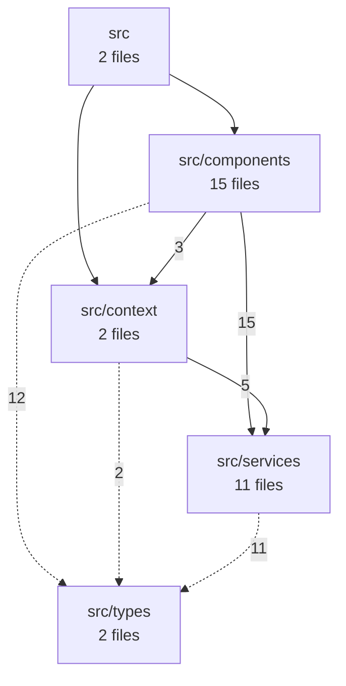

# surfmind — Project Onboarding Guide

_Generated automatically by <a href='https://gnost.readthedocs.io'>GNOST</a>._

## Project Overview

- **Root:** `/Users/mohdzain/Documents/GitHub/surfmind/surfmind`
- **Languages:** javascript (11), typescript (46)
- **Framework:** React

## Summary Table

| Language   | Files |   LOC |
| ---------- | ----: | ----: |
| JavaScript |    11 |  2215 |
| TypeScript |    82 | 11325 |

## Stats Table

| Language   | Files |  Code | Comments | Blanks |   LOC |
| ---------- | ----: | ----: | -------: | -----: | ----: |
| JavaScript |    11 |  2012 |        4 |    199 |  2215 |
| TypeScript |    82 | 10298 |       18 |   1009 | 11325 |

## Get it running

_Read from this project's own files. Each line names its source; nothing is guessed._

**Install**

- `npm install` _(package.json)_

**Build**

- `npm run build` _(package.json)_

**Run**

- `npm start` _(package.json)_

**Test**

- `npm test` _(package.json)_

**Environment variables**

- REACT_APP_HOST _(.env.example)_
- REACT_APP_SYNC_COUNT_THRESHOLD _(.env.example)_
- REACT_APP_SYNC_TIME_SAFETY_NET_MIN _(.env.example)_

## Entry Points

- `src/App.tsx` — Common JS entry filename
- `src/index.tsx` — Common JS entry filename

## Execution Flow (High Level)

- `src/index.tsx` → `src/reportWebVitals.ts`
- `src/index.tsx` → `src/App.tsx` → `src/components/Popup.tsx` → `src/components/Bookmarks.tsx`
- `src/index.tsx` → `src/App.tsx` → `src/components/Popup.tsx` → `src/components/Combined.tsx`
- `src/index.tsx` → `src/App.tsx` → `src/components/Popup.tsx` → `src/components/FastModeSettings.tsx`
- `src/index.tsx` → `src/App.tsx` → `src/components/Popup.tsx` → `src/components/SavedBookmarks.tsx`

_(30 additional paths omitted for clarity.)_

## Execution Flow (Overview)

> Grouped by folder to stay readable: 5 folders; numbers on arrows count the file-level imports they stand for.
> Dotted arrows: imports that do not run when the module loads.

> 📌 This diagram shows the high-level execution flow. For the complete flow, see [**flow/flow-full.md**](./flow/FLOW-full.md) Raw Mermaid: [flow/flow-full.mmd](./flow/FLOW-full.mmd) Every file and import, ungrouped (for tools and AI): [flow/flow-complete.mmd](./flow/flow-complete.mmd) Interactive explorer: run `gnost open flow` (the page is `flow.html` in this folder; it is rebuilt, not committed)

## Recommended Reading Order

### Start Here

- `src/index.tsx`

### Core Logic

- `src/App.tsx`
- `src/components/Popup.tsx`
- `src/context/UserState.tsx`
- `src/components/BookmarkFolderPicker.tsx`
- `src/components/Bookmarks.tsx`
- `src/components/Combined.tsx`
- `src/components/FastModeSettings.tsx`
- `src/components/PrivacySettings.tsx`
- `src/components/RatePromptBanner.tsx`
- `src/components/RecentSearches.tsx`
- `src/components/SavedBookmarks.tsx`
- `src/components/SearchModeToggle.tsx`
- `src/components/SearchThought.tsx`
- `src/components/SettingsHome.tsx`
- `src/components/SourceCard.tsx`
- _...and 16 more (closest to an entry point listed first)_

### Supporting / Leaf Code

- `src/reportWebVitals.ts`
- `src/components/SavedHistory.tsx`
- `src/components/SearchComposer.tsx`
- `src/components/Update.tsx`
- `src/components/UserId.tsx`
- `src/services/displayText.ts`
- `src/services/updateVersion.ts`
- `src/services/userFacingError.ts`
- `src/components/ConfirmationDialog.tsx`
- `src/services/storeConfig.ts`
- `src/types/bookmarks.ts`
- `src/types/search.ts`
- `src/types/sync.ts`

## 📘 First Files to Read

- **`src/index.tsx`**
  - Primary entry point into the application
- **`src/App.tsx`**
  - Primary entry point into the application
- **`src/components/Popup.tsx`**
  - Core logic file referenced by multiple execution paths
- **`src/context/UserState.tsx`**
  - Core logic file referenced by multiple execution paths
- **`src/components/SyncSettings.tsx`**
  - Core logic file referenced by multiple execution paths
- **`src/components/SettingsHome.tsx`**
  - Core logic file referenced by multiple execution paths
- **`src/reportWebVitals.ts`**
  - Frequently involved in execution flow
- **`src/components/LinkedBrowsers.tsx`**
  - Core logic file referenced by multiple execution paths
- **`src/components/PrivacySettings.tsx`**
  - Core logic file referenced by multiple execution paths
- **`src/components/RecentSearches.tsx`**
  - Core logic file referenced by multiple execution paths

## ⚠️ Caution Areas

### `src/components/Popup.tsx`

- **Type:** large_file
- **Severity:** 5
- **Caution score:** 90.2/100 (partial: some checks need Python)
- 1,099 lines of code; imports 26 project files; about 155 branches (estimated)

### `src/types/index.ts`

- **Type:** high_impact
- **Severity:** 4
- **Caution score:** 64.6/100 (partial: some checks need Python)
- Imported by 25 files

## Change Hotspots

Files that changed most in the last 365 days (64 commits). A file that changes often and is touched by many people is where merge conflicts and regressions tend to start.

| File                                 | Commits | Authors | Last 90 days | Lines changed | Last change |
| ------------------------------------ | ------: | ------: | -----------: | ------------- | ----------- |
| `src/components/Popup.tsx`           |      14 |       1 |           11 | +1706 / -884  | 2026-11-14  |
| `src/context/UserState.tsx`          |      10 |       1 |            7 | +731 / -229   | 2026-11-14  |
| `src/components/SettingsHome.tsx`    |       8 |       1 |            8 | +411 / -87    | 2026-11-14  |
| `src/components/SourceCard.tsx`      |       7 |       1 |            7 | +183 / -38    | 2026-11-14  |
| `src/components/Update.tsx`          |       8 |       1 |            5 | +329 / -117   | 2026-11-14  |
| `public/historySync.js`              |       6 |       1 |            6 | +507 / -63    | 2026-11-14  |
| `src/services/syncApi.ts`            |       6 |       1 |            6 | +334 / -40    | 2026-11-04  |
| `public/background.js`               |       6 |       1 |            5 | +377 / -115   | 2026-11-14  |
| `src/components/Bookmarks.tsx`       |       7 |       1 |            4 | +213 / -308   | 2026-11-14  |
| `public/bookmarkSync.js`             |       5 |       1 |            5 | +444 / -51    | 2026-11-14  |
| `src/components/PrivacySettings.tsx` |       5 |       1 |            5 | +318 / -29    | 2026-11-15  |
| `src/components/SyncSettings.tsx`    |       5 |       1 |            5 | +701 / -128   | 2026-11-04  |
| `src/services/privacy.ts`            |       5 |       1 |            5 | +136 / -16    | 2026-11-14  |
| `src/services/updateVersion.ts`      |       5 |       1 |            5 | +84 / -15     | 2026-11-14  |
| `public/structuredExtraction.js`     |       4 |       1 |            4 | +253 / -9     | 2026-11-14  |

## Risky and Changing

Files that are fragile to change (high caution score) and also change often. Start here when adding tests or reviewing changes. Risk = caution score scaled by how much the file changes.

| File                              | Risk | Caution | Change activity | Why fragile                    | Commits | Authors |
| --------------------------------- | ---: | ------: | --------------: | ------------------------------ | ------: | ------: |
| `src/components/Popup.tsx`        | 81.2 |    90.2 |              90 | large file, imports many files |      14 |       1 |
| `src/context/UserState.tsx`       | 24.8 |    28.5 |            87.1 | large file, imports many files |      10 |       1 |
| `src/components/SyncSettings.tsx` | 22.8 |    32.1 |            70.9 | large file, complex code       |       5 |       1 |

## 🔁 Circular Dependencies

_No circular dependencies detected._

## Key Execution Paths

To understand specific scenarios, see the entry-based execution paths:

- 📍 [Entry-based Paths](flow/entry-paths.md)

- 🧭 [folder-based Paths](flow/folder-paths.md)

(Whole system: [flow/FLOW-full.md](flow/FLOW-full.md). For a small project it is the same as [flow/flow-complete.mmd](flow/flow-complete.mmd), every file and import; for a big one FLOW-full groups them by folder to stay readable. Interactive: `gnost open flow`.)

---

Generated by [GNOST](https://gnost.readthedocs.io) 0.7.0rc2. Try it on your own code: `npx gnost-cli onboard .`
