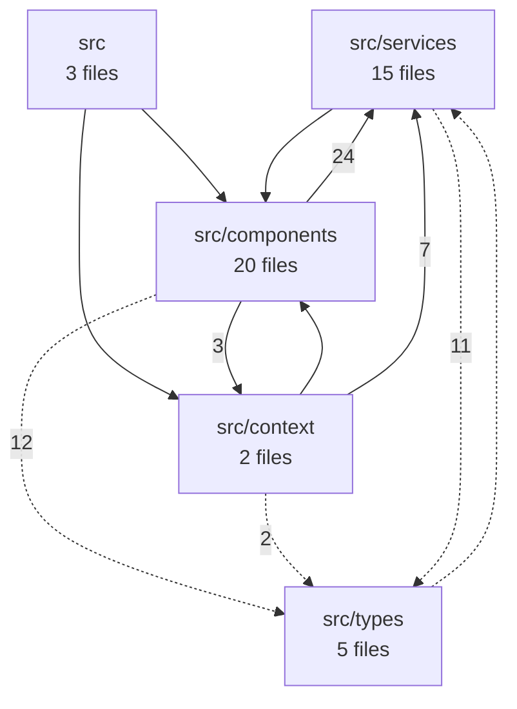
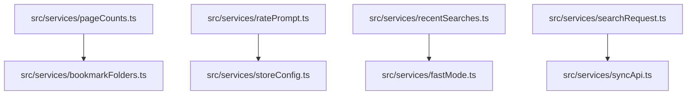
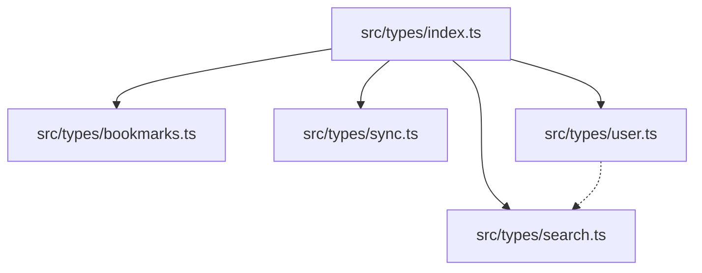
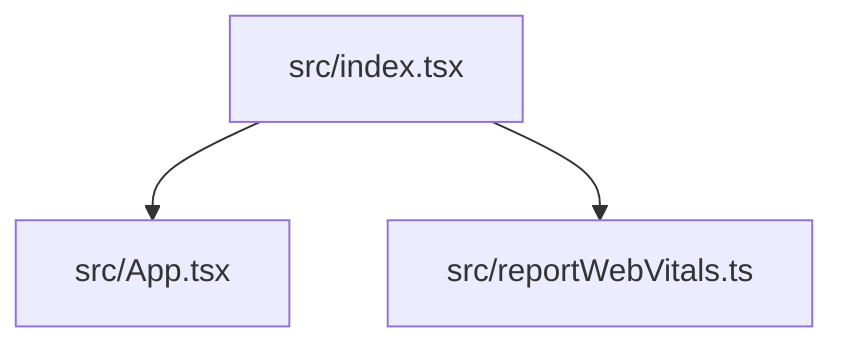
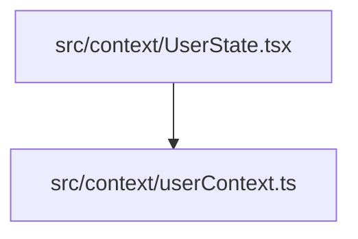

# Full Execution Flow

> Grouped by folder to stay readable: 5 folders; numbers on arrows count the file-level imports they stand for.
> Dotted arrows: imports that do not run when the module loads.

# Detail by folder

The diagram above groups files by folder. These show the files inside the biggest folders.

## `src/components` (20 files)

```mermaid
flowchart TD
  src_components_BookmarkFolderPicker_tsx["src/components/BookmarkFolderPicker.tsx"]
  src_components_Bookmarks_tsx["src/components/Bookmarks.tsx"]
  src_components_Combined_tsx["src/components/Combined.tsx"]
  src_components_ConfirmationDialog_tsx["src/components/ConfirmationDialog.tsx"]
  src_components_FastModeSettings_tsx["src/components/FastModeSettings.tsx"]
  src_components_LinkedBrowsers_tsx["src/components/LinkedBrowsers.tsx"]
  src_components_Popup_tsx["src/components/Popup.tsx"]
  src_components_PrivacySettings_tsx["src/components/PrivacySettings.tsx"]
  src_components_RatePromptBanner_tsx["src/components/RatePromptBanner.tsx"]
  src_components_RecentSearches_tsx["src/components/RecentSearches.tsx"]
  src_components_SavedBookmarks_tsx["src/components/SavedBookmarks.tsx"]
  src_components_SavedHistory_tsx["src/components/SavedHistory.tsx"]
  src_components_SearchComposer_tsx["src/components/SearchComposer.tsx"]
  src_components_SearchModeToggle_tsx["src/components/SearchModeToggle.tsx"]
  src_components_SearchThought_tsx["src/components/SearchThought.tsx"]
  src_components_SettingsHome_tsx["src/components/SettingsHome.tsx"]
  src_components_SourceCard_tsx["src/components/SourceCard.tsx"]
  src_components_SyncSettings_tsx["src/components/SyncSettings.tsx"]
  src_components_Update_tsx["src/components/Update.tsx"]
  src_components_Bookmarks_tsx --> src_components_BookmarkFolderPicker_tsx
  src_components_Bookmarks_tsx --> src_components_SearchComposer_tsx
  src_components_Combined_tsx --> src_components_SearchComposer_tsx
  src_components_LinkedBrowsers_tsx --> src_components_ConfirmationDialog_tsx
  src_components_Popup_tsx --> src_components_BookmarkFolderPicker_tsx
  src_components_Popup_tsx --> src_components_Bookmarks_tsx
  src_components_Popup_tsx --> src_components_Combined_tsx
  src_components_Popup_tsx --> src_components_FastModeSettings_tsx
  src_components_Popup_tsx --> src_components_PrivacySettings_tsx
  src_components_Popup_tsx --> src_components_RatePromptBanner_tsx
  src_components_Popup_tsx --> src_components_RecentSearches_tsx
  src_components_Popup_tsx --> src_components_SavedBookmarks_tsx
  src_components_Popup_tsx --> src_components_SavedHistory_tsx
  src_components_Popup_tsx --> src_components_SearchComposer_tsx
  src_components_Popup_tsx --> src_components_SearchModeToggle_tsx
  src_components_Popup_tsx --> src_components_SearchThought_tsx
  src_components_Popup_tsx --> src_components_SettingsHome_tsx
  src_components_Popup_tsx --> src_components_SourceCard_tsx
  src_components_Popup_tsx --> src_components_SyncSettings_tsx
  src_components_Popup_tsx --> src_components_Update_tsx
  src_components_PrivacySettings_tsx --> src_components_ConfirmationDialog_tsx
  src_components_RecentSearches_tsx --> src_components_SourceCard_tsx
  src_components_SyncSettings_tsx --> src_components_ConfirmationDialog_tsx
  src_components_SyncSettings_tsx --> src_components_LinkedBrowsers_tsx
```

## `src/services` (15 files)

## `src/types` (5 files)

> Dotted arrows: imports that do not run when the module loads.

## `src` (3 files)

## `src/context` (2 files)

> ℹ️ This file renders the complete Mermaid diagram on GitHub.
> For raw Mermaid source, see [**FLOW-full.mmd**](./FLOW-full.mmd). Every file and import, ungrouped and nothing omitted: [**flow-complete.mmd**](./flow-complete.mmd)

---

Generated by [GNOST](https://gnost.readthedocs.io) 0.7.0rc2. Try it on your own code: `npx gnost-cli onboard .`
