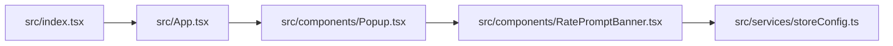

# Entry-based Execution Paths

These diagrams show individual execution paths starting from application entry points. Each path represents one possible flow through the system.

## Path 1 — `src/index.tsx`

```mermaid
flowchart LR
  src_App_tsx["src/App.tsx"]
  src_components_BookmarkFolderPicker_tsx["src/components/BookmarkFolderPicker.tsx"]
  src_components_Popup_tsx["src/components/Popup.tsx"]
  src_index_tsx["src/index.tsx"]
  src_services_bookmarkFolders_ts["src/services/bookmarkFolders.ts"]
  src_App_tsx --> src_components_Popup_tsx
  src_components_BookmarkFolderPicker_tsx --> src_services_bookmarkFolders_ts
  src_components_Popup_tsx --> src_components_BookmarkFolderPicker_tsx
  src_index_tsx --> src_App_tsx
```

**Execution chain:** src/index.tsx → src/App.tsx → src/components/Popup.tsx → src/components/BookmarkFolderPicker.tsx → src/services/bookmarkFolders.ts

## Path 2 — `src/index.tsx`

```mermaid
flowchart LR
  src_App_tsx["src/App.tsx"]
  src_components_ConfirmationDialog_tsx["src/components/ConfirmationDialog.tsx"]
  src_components_Popup_tsx["src/components/Popup.tsx"]
  src_components_PrivacySettings_tsx["src/components/PrivacySettings.tsx"]
  src_index_tsx["src/index.tsx"]
  src_App_tsx --> src_components_Popup_tsx
  src_components_Popup_tsx --> src_components_PrivacySettings_tsx
  src_components_PrivacySettings_tsx --> src_components_ConfirmationDialog_tsx
  src_index_tsx --> src_App_tsx
```

**Execution chain:** src/index.tsx → src/App.tsx → src/components/Popup.tsx → src/components/PrivacySettings.tsx → src/components/ConfirmationDialog.tsx

## Path 3 — `src/index.tsx`

**Execution chain:** src/index.tsx → src/App.tsx → src/components/Popup.tsx → src/components/RatePromptBanner.tsx → src/services/storeConfig.ts

---

Generated by [GNOST](https://gnost.readthedocs.io) 0.7.0rc2. Try it on your own code: `npx gnost-cli onboard .`
